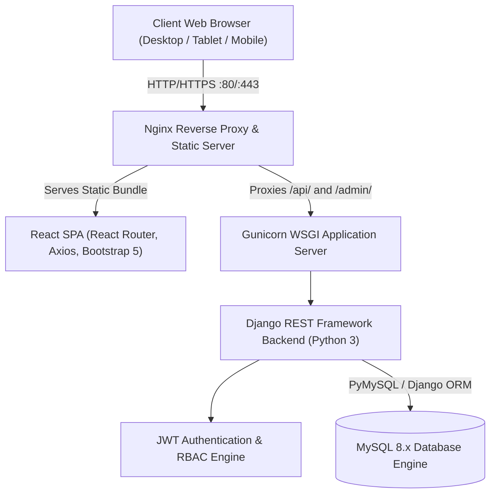
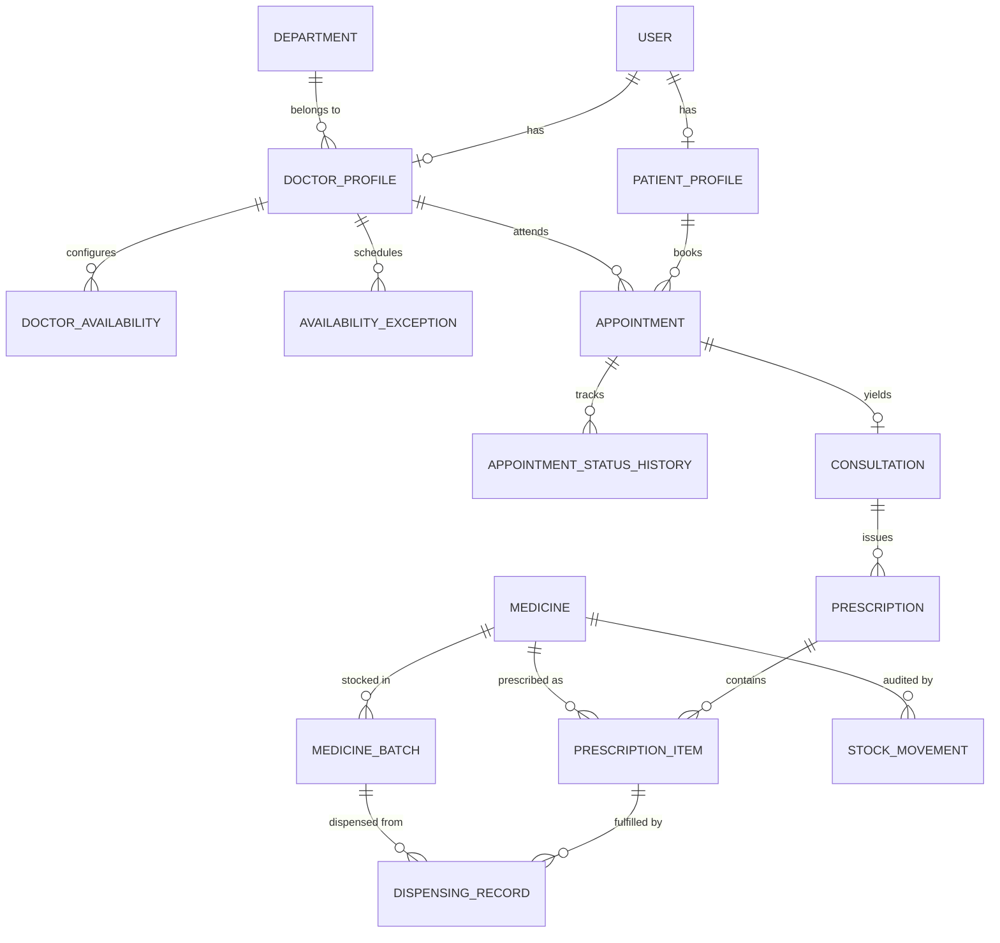
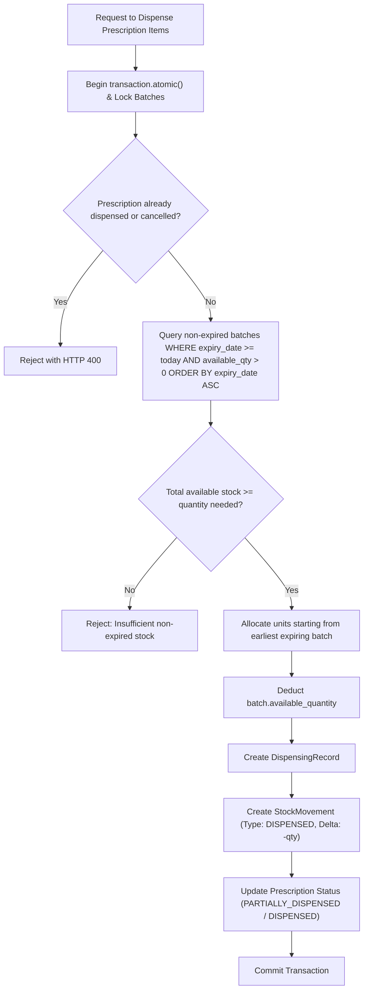

# Healthcare Management System (HMS) - Architecture & System Design

## 1. System Overview

CarePulse HMS is an enterprise-grade, multi-role clinical management system engineered for outpatient medical clinics, multi-specialty polyclinics, and healthcare centers. The architecture adopts a decoupled client-server paradigm comprising a high-performance Python/Django REST API backend and a responsive React single-page application (SPA).



---

## 2. Database Schema & Entity Relationship Diagram (ERD)



---

## 3. Concurrency Control & Double-Booking Prevention

To eliminate race conditions when multiple patients or staff book appointments simultaneously, booking logic operates within an isolated database transaction:

```python
with transaction.atomic():
    overlapping = Appointment.objects.select_for_update().filter(
        doctor=doctor,
        appointment_date=appointment_date,
        start_time__lt=end_time,
        end_time__gt=start_time
    ).exclude(status=AppointmentStatus.CANCELLED)

    if overlapping.exists():
        raise ValidationError("This time slot is no longer available.")
    
    appointment = super().create(validated_data)
```

1. **`select_for_update()`**: Acquires an exclusive row-level lock on the doctor's appointment records for that date.
2. **Atomic Rollback**: If a concurrent thread claims the slot milliseconds earlier, the second request fails cleanly with an HTTP 400 validation error without writing partial state.
3. **Rescheduling Protection**: Rescheduling executes in a single transaction. The existing slot is never released unless the new target slot is successfully reserved and verified.

---

## 4. FEFO (First-Expiry-First-Out) Dispensing Algorithm

Prescriptions must never dispense expired pharmaceuticals. When fulfilling prescription items, the system utilizes an automated FEFO batch allocation:



---

## 5. Security & Privacy Guarantees

1. **Least-Privilege Scoping**: Database queries are automatically scoped in the viewset layer based on the user's role. A patient's queryset queries `Appointment.objects.filter(patient=user.patient_profile)`, making enumeration of other patients impossible.
2. **Clinical Notes Isolation**: Receptionists and pharmacists do not have permission to view or edit clinical diagnosis or raw examination text.
3. **Password Security**: Passwords are saved exclusively using PBKDF2 with a SHA256 hash. Plain-text passwords are never stored or logged.
4. **Token Security**: Tokens use HMAC-SHA256 signing with secret key rotation. Expired tokens are rejected automatically with 401 Unauthorized.
